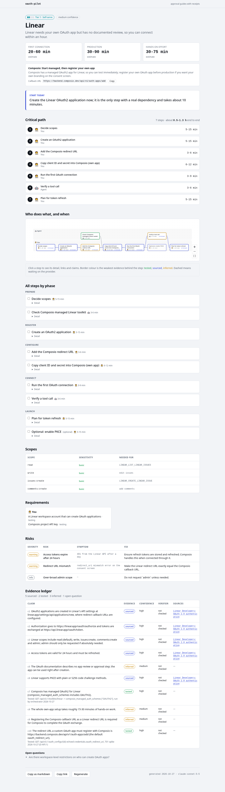
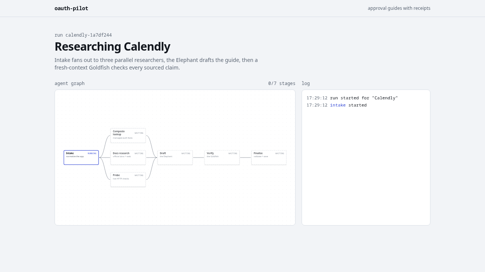

# OAuth Pilot

**How hard is it to get a production OAuth app for the provider your agent needs, and what should you start today?**
OAuth Pilot answers that with a source-cited guide: a difficulty tier (0 to 4), two clocks (time to first working connection, time to production including review waits), a critical-path diagram, and an evidence ledger that says which claims were tested, sourced or merely inferred. It is built around [Composio](https://composio.dev) auth configs, and it ships as a web app, an MCP server and a Claude Code plugin that share one agent and one guide schema.

- Library: 5 audited guides (Linear, Google Calendar, Gmail, Salesforce, Shopify).
- Any other app: an agent (LangGraph JS) researches it live, drafts a guide, then a fresh-context verifier re-checks every claim against its cited source.
- Status: runs locally only. Deploy was cut (see [Limitations](#limitations-and-next-steps)); there is no public URL.

## Run it locally

Needs Node >= 22 and pnpm 12.

```bash
pnpm install
cp .env.example .env            # only needed for live mode (see below)

# Fake mode: no keys, replays recorded fixtures. Good for a first look.
pnpm --filter web build
OAUTH_PILOT_FAKE=1 pnpm --filter web start      # http://localhost:3000
```

Open http://localhost:3000. The 5 library guides work in any mode. In fake mode, "Generate guide" replays recordings for **Linear** and **Calendly** only.

Dev server: `OAUTH_PILOT_FAKE=1 pnpm --filter web dev`. Verify everything offline: `pnpm test:all` (typecheck, unit, guide validation, web e2e, MCP e2e; no keys needed).

### Live mode

Fill `.env` (never commit it; it is git-ignored). Variables in `.env.example`: `ANTHROPIC_BASE_URL`, `ANTHROPIC_API_KEY`, `COMPOSIO_API_KEY`, `OAUTH_PILOT_MODEL`, `OAUTH_PILOT_URL`, `OAUTH_PILOT_FAKE`, `DATA_DIR`, `GUIDES_DIR`. The ones that matter:

| Variable | Purpose |
|---|---|
| `ANTHROPIC_API_KEY` | Any Anthropic-compatible key (real, or a LiteLLM virtual key) |
| `ANTHROPIC_BASE_URL` | Optional gateway URL; empty means api.anthropic.com |
| `COMPOSIO_API_KEY` | Composio toolkit and required-scope lookups |
| `OAUTH_PILOT_MODEL` | Default `claude-sonnet-5-5` |
| `DATA_DIR`, `GUIDES_DIR` | Where generated guides and run logs go (`./data`), and the committed library (`./guides`) |

> **Heads-up:** the web app (Next.js) does **not** read the root `.env`; the CLI does. Export it before starting the web app:

```bash
set -a; . ./.env; set +a
pnpm --filter web build && pnpm --filter web start
```

Command line (reads `.env` itself; add `OAUTH_PILOT_FAKE=1` to replay instead):

```bash
pnpm --filter @oauth-pilot/agent guide "Slack"
pnpm --filter @oauth-pilot/agent guide "Notion" --use-case "read pages" --tools NOTION_FETCH_DATA
```

A live run takes a few minutes and writes `data/guides/<slug>.json`, which the web app serves at `/guides/<slug>`.

## 60-second tour

1. **Library** (`/`): five guides with tier badges and both clocks, plus a box to generate a guide for any app.
2. **Guide page** (`/guides/gmail`): verdict, "start today" line, critical-path diagram (the CASA security assessment is the long pole), risks with the error text you will see and the fix, and the evidence ledger. "Copy as markdown" shares it.

   

3. **Live run** (`/runs/<id>`): submit an app and watch the graph light up node by node (intake, composio_lookup, docs_research, probe, draft, verify, finalize), then land on the new guide.

   

Reviewer script with exact clicks: [docs/DEMO.md](docs/DEMO.md).

## What the tiers mean

The tier is computed from the guide's facts by a deterministic rule (first match from the top wins), not chosen by the LLM:

| Tier | Label | Rule |
|---|---|---|
| 4 | Gated | Any requirement or risk is a gate: partner program, contract, sales contact or paid tier needed for API access at all |
| **3** | **Heavy review** | Some step waits on the provider for **one week or more** (>= 168 h), or any **restricted** scope is requested |
| 2 | Light review | Any provider-review step, any sensitive or admin scope, or a requirement owned by an admin |
| 1 | Self-serve | You need your own OAuth app, but nothing needs review |
| 0 | Instant | Composio's managed app is enough and nothing needs review |

**Tier 3 in practice:** you can start on day one, but production access sits behind a review that takes weeks, so you must begin it early. Gmail is tier 3 because `gmail.readonly` is a restricted scope (yearly CASA security assessment); Shopify is tier 3 on an estimated 1 to 3 week app review (without that estimate the rubric gives 2). Library tiers: Linear 0, Google Calendar 2, Salesforce 2, Gmail 3, Shopify 3.

**Two clocks.** *Time to first working connection* is you testing with your own account. *Time to production* is any user connecting, including review waits. Each step also has an actor: `agent` (can be automated), `developer`, `admin` (someone else in your org) or `provider` (waiting on review).

## How evidence works

Every factual claim in a guide carries one of three labels:

| Label | Meaning | Rule |
|---|---|---|
| **tested** | We ran it and recorded how | Only code-made claims can be tested. Examples: a probe of a provider's `.well-known` OAuth metadata, the Composio toolkit lookup (managed app, auth scheme), and the T22 Linear connections (API key and managed OAuth) that reached ACTIVE and made working tool calls. A model cannot declare something tested; such a claim is demoted to inferred. |
| **sourced** | A page says so | At least one source with URL, an exact quote and a fetch date. The verifier re-fetches the page and checks the quote. |
| **inferred** | Reasoned, not confirmed | Our judgement, shown with low or medium confidence. Where two official pages disagree (for example Salesforce security-review fees), both values are shown. |

The pattern is draft, then verify with fresh context: a drafting call with all the research writes the guide, then a separate verifier that sees only the claims and their cited sources downgrades or removes anything the source does not support. A page the verifier cannot read is `not_checked`, never silently "unsupported". Schema and rubric: `docs/plan/02_GUIDE_SCHEMA.md`.

## Verification summary

End-to-end results (offline suites plus live web, CLI, MCP and Claude Code plugin runs, with timings and bugs found and fixed): [docs/E2E_RESULTS.md](docs/E2E_RESULTS.md).

The agent generated the 5 library guides live. Fresh-context auditors then checked every claim against hand-built evidence packs (`research/apps/*.md`) and re-fetched cited pages.

- Claims in the library: **after the audit** ([SUMMARY](docs/verification/SUMMARY.md)) 118 = 11 tested, 86 sourced, 21 inferred (before: 113 = 11 / 66 / 36). **Today** (recounted from `guides/*.json`) 123 = 16 tested, 86 sourced, 21 inferred, because T22 added 5 tested claims to the Linear guide.
- No claim was found factually wrong. Verifier "unsupported" verdicts fell from 28 to 7: 20 were fetch artifacts (JS-rendered pages, truncated long pages), and the verifier now falls back to the `web_fetch` server tool.
- One tier changed: Salesforce 1 to 2 (the agent missed the org-admin approval step).
- Not verifiable: 7 Salesforce claims on help.salesforce.com (serves a JS shell), Gmail CASA cost and duration (single source), whether Shopify needs a Partner account for custom distribution.

Details: [docs/verification/SUMMARY.md](docs/verification/SUMMARY.md) and per-app reports in `docs/verification/`.

**Setup attempts (T22, Linear):** [docs/verification/setup-attempts.md](docs/verification/setup-attempts.md). Real attempts through Composio on 2026-10-28:
- Creating a Linear OAuth app by API failed: it needs the `oauth:create` scope on the API key.
- The Composio API-key path reached ACTIVE immediately and two tool calls worked (tested).
- The managed OAuth path first reached Linear's consent screen (callback URL and scopes observed); two attempts expired because Authorize was not clicked within 10 minutes. A third connection then reached ACTIVE in about 13 s (the workspace had already authorized the app, so no consent screen) and `LINEAR_GET_CURRENT_USER` and `LINEAR_LIST_LINEAR_ISSUES` succeeded (tested). `LINEAR_CREATE_LINEAR_ISSUE` was not run.

## Claude Code plugin

From a local checkout (works for everyone), at the repo root:

```bash
claude plugin marketplace add ./
claude plugin install oauth-pilot@oauth-pilot
```

Or load it for one session without installing: `claude --plugin-dir plugin/oauth-pilot`.

Via GitHub: `claude plugin marketplace add manaspros/oauth-pilot`, then the same `install` line. This works only for people with access to the repo, which is private for now.

The plugin provides skills `/oauth-pilot:oauth-guide <app>` (verdict and next actions; uses the bundled MCP server, with an in-session research-and-verify fallback) and `/oauth-pilot:oauth-setup <app>` (walks through creating the OAuth app and Composio auth config, handing off to you at every login, 2FA, payment, terms or submit-for-review step), a read-only `oauth-goldfish` verifier agent, and fill-in templates (privacy policy, scope justification, demo video script). Secrets go only in `.env`, never in chat. Set `ANTHROPIC_API_KEY` (and optionally `ANTHROPIC_BASE_URL`, `COMPOSIO_API_KEY`) in the environment Claude Code starts in for live runs.

### MCP config for any client

The server is a single bundled file, `plugin/oauth-pilot/bin/mcp.mjs`, committed to the repo, so it works from a fresh clone with no build or install step. It runs the agent in-process (the web app need not be running). Tools: `oauth_guide_list`, `oauth_guide_get`, `oauth_guide_start`, `oauth_guide_status`.

```json
{
  "mcpServers": {
    "oauth-pilot": {
      "command": "node",
      "args": ["/absolute/path/to/oauth-pilot/plugin/oauth-pilot/bin/mcp.mjs"],
      "env": {
        "DATA_DIR": "/absolute/path/to/oauth-pilot/data",
        "ANTHROPIC_API_KEY": "<your key>",
        "COMPOSIO_API_KEY": "<your key>"
      }
    }
  }
}
```

Add `"OAUTH_PILOT_FAKE": "1"` to run without keys. Rebuild the bundle only after changing `guides/` or prompts: `pnpm --filter @oauth-pilot/mcp build`.

## Key decisions

Locked product decisions are in [docs/plan/00_PLAN.md](docs/plan/00_PLAN.md): scope-aware verdict, two clocks, computed five-tier rubric, an actor on every step, the evidence ledger, draft-then-verify with fresh context, "start today" plus a risk playbook, a generated-then-audited library, shareable guide URLs. Architecture: [docs/plan/01_ARCHITECTURE.md](docs/plan/01_ARCHITECTURE.md). Every later change is an ADR-style entry in [DECISIONS.md](DECISIONS.md). Layout: `packages/core` (schema, rubric, critical path, markdown), `packages/agent` (graph, CLI), `packages/mcp`, `apps/web`, `plugin/oauth-pilot`, `guides/` (the library).

## Limitations and next steps

- **Only 5 guides.** Any other app is generated live and is less checked than the audited five. Next: grow to about 100 guides.
- **No re-verification cron and no doc-drift detection.** Guides are dated snapshots (2026-10-27) and provider consoles change. Next: scheduled re-verification, plus alerts when a cited page changes.
- **No community-reported durations.** Review times are provider-stated or estimated. Next: let developers report real wait times.
- **Verifier fetch limits.** JS-rendered pages and very long pages (one Shopify page is 138k chars) can be unreadable. help.salesforce.com is a JS shell, so 7 Salesforce claims stay inferred with low confidence. Regenerating the guides would apply the newer verifier and prompt rules.
- **Some tiers rest on estimates.** Shopify's tier 3 relies on an estimated review time; Linear's tier 0 assumes the managed app is enough for production.
- **Not deployed.** The deploy task was cut; run locally. A recorded demo video is a next step.
- **Setup is only partly proven.** Linear managed OAuth reached ACTIVE and listed issues, but issue creation was not run (see setup attempts). No real provider approval, such as Google verification or CASA, was submitted.
- Fake mode replays Linear and Calendly only; live runs need your own keys and cost LLM tokens.

## Credits

Built and reviewed with the [Elephant–Goldfish Model](https://github.com/google/elephant-goldfish-model) (google/elephant-goldfish-model, Apache-2.0): an orchestrator that holds the plan, and fresh-context reviewers that see only the work. The same pattern runs inside the product as the draft/verify split and the `oauth-goldfish` agent. The `oauth-goldfish` mandate is based on the model's design-critic mandate.

Licensed MIT (see plugin manifest).
