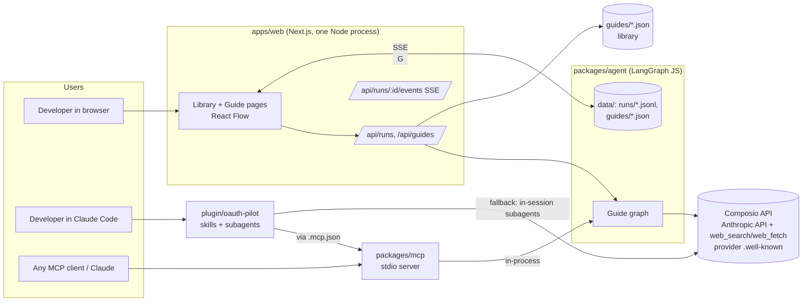
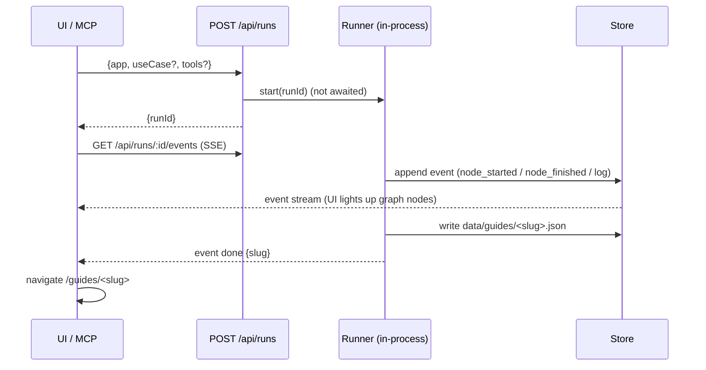

# 01 — Architecture

## Repo layout (pnpm workspace, TypeScript everywhere, Node ≥ 22)

```
.
├── CLAUDE.md                  # orchestrator protocol (how a session executes TASKS.md)
├── TASKS.md                   # task board — single source of truth for progress
├── LOG.md                     # append-only work log
├── DECISIONS.md               # decision records (ADR-lite)
├── docs/plan/*.md             # specs (this folder)
├── docs/research/             # problem framing
├── docs/verification/<slug>.md# per-app audit: confirmed / corrected / unverifiable / tested
├── research/apps/<slug>.md    # hand-built evidence packs (ground truth for audits)
├── guides/<slug>.json         # library guides (committed, schema-valid)
├── packages/
│   ├── core/                  # @oauth-pilot/core — zod schema, tier rubric, critical path, md renderer
│   ├── agent/                 # @oauth-pilot/agent — LangGraph graph, nodes, run store, CLI
│   └── mcp/                   # @oauth-pilot/mcp — MCP stdio server (calls the web API)
├── apps/web/                  # Next.js App Router + React Flow UI + HTTP API (runs the agent)
├── plugin/oauth-pilot/        # Claude Code plugin (skills, agents, .mcp.json, templates)
├── .claude-plugin/marketplace.json   # makes the repo installable as a plugin marketplace
└── e2e/                       # Playwright + MCP + plugin e2e tests
```

## System diagram



## Data flow for one live run



## Key technical choices

| Choice | Decision | Why |
|---|---|---|
| Language | TypeScript monorepo, pnpm workspaces | One schema shared by agent, web, MCP and plugin scripts |
| Agent framework | `@langchain/langgraph` + `@langchain/anthropic` | User asked for a LangGraph-style autonomous agent. Gives a typed state graph and parallel fan-out |
| LLM gateway | LiteLLM proxy via `ANTHROPIC_BASE_URL` + `ANTHROPIC_API_KEY`. `ChatAnthropic` gets `anthropicApiUrl`/`clientOptions.baseURL` from env | Confirmed 2026-10-27: the proxy serves `claude-sonnet-5-5` and passes Anthropic server tools (web_search returned results). Never commit the proxy URL |
| Models | `claude-sonnet-5-5` for all nodes (env `OAUTH_PILOT_MODEL`) | Cost and speed. Live run target < 3 min |
| Web research | Anthropic server tools `web_search` + `web_fetch` | No extra API keys. Citations come back with URLs. **Verify in spike T01** |
| Composio data | REST `backend.composio.dev/api/v3.1` with `x-api-key` | Toolkit details, managed schemes, scope ceiling, required scopes for tools |
| Web | Next.js 15 App Router, Tailwind, `@xyflow/react`, `@dagrejs/dagre` for layout | React Flow for the swimlane critical-path diagram and the live agent graph |
| Live updates | Server-Sent Events from a JSONL event log per run | Simple. Works through the MCP status poll too |
| Storage | Filesystem: `guides/` (library, committed), `data/guides/`, `data/runs/` (generated, gitignored) | No database needed. Deploy target has a persistent volume |
| MCP | `@modelcontextprotocol/sdk`, stdio. Imports the agent and runs the graph in-process. Bundled by tsup to `plugin/oauth-pilot/bin/mcp.mjs` | Works without the web app running. Shares `DATA_DIR`, so runs show on the web when both run locally |
| Deploy (Tier C) | Any single-container host (Railway first). `data/` may be ephemeral, since the library is committed | Long-lived Node process for in-process runs plus SSE. Vercel serverless would cut runs off |
| Tests | vitest (unit/integration), Playwright (web e2e), node script (MCP e2e), `claude -p --plugin-dir` (plugin smoke) | See `07_TESTING.md` |
| Fake mode | `OAUTH_PILOT_FAKE=1` replays recorded LLM/HTTP fixtures | CI and e2e without keys. Demo-safe fallback |

## How packages consume each other

- `packages/core` and `packages/agent`: `"main"`/`"exports"` → `./src/index.ts` (source TS; no build step). Each has `typecheck` (`tsc --noEmit`) and `test` (vitest) scripts.
- `apps/web`: `next.config.ts` sets `transpilePackages: ["@oauth-pilot/core", "@oauth-pilot/agent"]`. Agent code runs only in route handlers and server components (`export const runtime = "nodejs"`).
- `packages/mcp`: `build` = tsup bundle → `plugin/oauth-pilot/bin/mcp.mjs` (committed, so installed plugins work). Root `e2e:mcp` and `test:all` run the build first.
- Package names: `@oauth-pilot/core`, `@oauth-pilot/agent`, `@oauth-pilot/mcp`, `web`.

## Environment variables (`.env.example`)

```
ANTHROPIC_BASE_URL=       # LiteLLM proxy (Anthropic-compatible /v1/messages passthrough); empty = api.anthropic.com
ANTHROPIC_API_KEY=        # LiteLLM virtual key (or real Anthropic key); required for live runs
COMPOSIO_API_KEY=         # optional; without it composio_lookup is skipped and noted as a gap
OAUTH_PILOT_MODEL=claude-sonnet-5-5
OAUTH_PILOT_URL=http://localhost:3000   # optional; MCP uses it only to print web links
GUIDES_DIR=./guides                    # library guides location
OAUTH_PILOT_FAKE=0
DATA_DIR=./data
```

Secrets never go in the repo. `.env` is gitignored. The orchestrator runs a secret grep before each commit (see CLAUDE.md).
