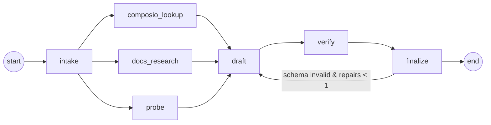

# 03 — Autonomous agent (LangGraph JS) + MCP server

Package: `packages/agent` (`@oauth-pilot/agent`). Entry points:
- `runGuide(input, { runId, emit, store }) → Promise<Guide>`: the graph.
- CLI `pnpm --filter @oauth-pilot/agent guide "<app or url>" [--use-case "..."] [--tools A,B] [--out <dir>] [--kind library|live] [--record]`
  - `--out <dir>` writes `<dir>/<slug>.json` (default `DATA_DIR/guides`); `--kind` sets `generator.kind` (default `live`);
    `--record` saves each node's output to `packages/agent/fixtures/runs/<slug>/<node>.json`.
  - Env loads via `node --env-file=.env` through `tsx --env-file=../../.env`. No dotenv dependency.

Wiring notes (do not re-derive):
- Fan-in: `addEdge(["composio_lookup","docs_research","probe"], "draft")` so draft runs once after all three.
- `finalize` returns `{ repairs: state.repairs + 1 }` when it routes back to `draft`.

## Graph



### State (LangGraph `Annotation.Root`)

```ts
{
  input: { app: string; useCase?: string; tools?: string[] },
  runId: string,
  target: { name: string; slug: string; website?: string; composioSlug?: string; docsHints: string[] } | null,
  composio: ComposioFacts | null,      // see composio_lookup
  research: ResearchNote[],            // reducer: concat
  probes: ProbeResult[],               // reducer: concat
  draft: unknown | null,               // raw JSON from draft node
  guide: Guide | null,
  issues: string[],                    // reducer: concat (validation errors, skipped nodes)
  repairs: number,
}
type ResearchNote = { id: string; topic: Topic; finding: string; url: string; title: string; quote: string };
type Topic = "registration" | "review_process" | "scopes" | "requirements" | "limits" | "gotchas" | "errors";
type ProbeResult = { id: string; check: string; url: string; ok: boolean; status?: number; observed: string; at: string };
```

### Nodes

| Node | LLM? | What it does | Output |
|---|---|---|---|
| `intake` | yes (small, no tools) | Normalize "Pipedrive" / "https://pipedrive.com" into name, slug, website, likely Composio slug, and 3–6 doc search hints | `target` |
| `composio_lookup` | no | `GET /api/v3.1/toolkits/{slug}`: managed schemes, `composio_managed_auth[].scopes.available`, `auth_config_details[].required_scopes`, `auth_guide_url`. If `input.tools` is given, call the required-scopes endpoint (verify path in T01). Missing key or 404 → `composio = { toolkitFound:false }` plus an issue | `composio` |
| `docs_research` | yes + `web_search` (max_uses 8) + `web_fetch` (max_uses 6) | One agentic call with a fixed brief. Find, **from official provider docs first**: how to register an OAuth app, the review/verification program and its timeline, scope sensitivity tiers, non-code requirements, rate limits or distribution limits, common errors. Return JSON `ResearchNote[]`. Every note needs a URL and a verbatim quote of 400 chars or fewer | `research` |
| `probe` | no | Deterministic HTTP checks, 5 s timeout each: `/.well-known/oauth-authorization-server` and `/.well-known/openid-configuration` on the website and `api.`/`auth.` subdomains; record `registration_endpoint` (dynamic client registration means no manual app is needed for MCP-style clients); HEAD the developer console and docs URLs from research hints | `probes` |
| `draft` (Elephant) | yes, structured output (tool-use with the Guide JSON schema) | Sees everything. Builds the Guide. Rules: each fact is a claim citing note URLs/quotes or probe ids. Probes become `tested` claims with `testedHow`. Anything without a source becomes `inferred` with `confidence: low`. Steps must be concrete (console URL, button and field names, callback URL value). Uses the tier rubric | `draft` |
| `verify` (Goldfish) | yes + `web_fetch` | **Fresh context**: receives ONLY `claims[]` (text + sources). No research notes, no conversation. For each `sourced` claim it re-fetches the URL (cache per run, max 10 fetches) and judges supported / partially / unsupported / contradicted. Unsupported → evidence `inferred`, confidence `low`. Contradicted → claim text replaced with the corrected statement plus source, or the claim removed and its references dropped. Adds an `openQuestions` entry for each claim it could not check | patched `draft` |
| `finalize` | no | `Guide.safeParse` → `validateGuide` → force `verdict.tier = computeTier()` → check `timeToProduction` against `criticalPath`. If invalid and `repairs < 1` → back to `draft` with errors in `issues`. Else save to `DATA_DIR/guides/<slug>.json`, emit `done` | `guide` |

Prompts live in `packages/agent/src/prompts/*.md`, loaded at runtime. Keep them under ~120 lines each. They must include the tier rubric text and the actor definitions from `02_GUIDE_SCHEMA.md`.

### Events (append to `DATA_DIR/runs/<runId>.jsonl`)

```ts
type RunEvent =
  | { t: "run_started"; runId; input; at }
  | { t: "node_started"; node: NodeName; at }
  | { t: "node_finished"; node: NodeName; at; summary: string }   // e.g. "14 notes from 6 sources"
  | { t: "log"; node: NodeName; msg: string; at }                  // e.g. "searching: gmail restricted scopes CASA"
  | { t: "done"; slug: string; tier: number; at }
  | { t: "error"; node?: NodeName; msg: string; at };
```

`node_started` and `node_finished` come from LangGraph `streamEvents`/`stream` (`streamMode: "updates"`) plus explicit `emit` calls inside nodes. The UI and MCP status read this file only.

### Budgets and failure handling

- Hard timeout per run: 300 s (AbortController). On timeout: if `draft` exists, finalize it with an issue. Otherwise emit `error`.
- Any single node failure except `draft` → record in `issues` and continue (degraded guide, lower confidence, openQuestion added).
- Prompt caching: put the static system prompt (rubric, schema description) first and mark it `cache_control`.

### Fake mode (`OAUTH_PILOT_FAKE=1`)

`packages/agent/fixtures/runs/<slug>/` holds recorded node outputs (`intake.json`, `composio.json`, `research.json`, `probes.json`, `draft.json`, `verify.json`). In fake mode each node returns its recorded output after 300–800 ms instead of calling the network or LLM. The graph, events and finalize all run for real. Record with `--record` on a live run. Unit tests use small inline fixtures, not fake mode.

- Before T14 there are no recordings. T10 creates `fixtures/runs/linear/` by hand from the core Linear fixture (draft.json = verify.json = the guide; other files minimal).
- T14 records `calendly` live. It is used by e2e as the "unfamiliar app" and is the demo-safe fallback if a live run fails on stage.

## HTTP API (in `apps/web`, calls `packages/agent`)

| Method | Path | Body / result |
|---|---|---|
| POST | `/api/runs` | `{app, useCase?, tools?}` → `{runId}`. Starts `runGuide` without awaiting it. Max 2 concurrent runs; otherwise 429 |
| GET | `/api/runs/:id` | `{status: running|done|error, events: RunEvent[], slug?}` |
| GET | `/api/runs/:id/events` | SSE: replays existing events, then tails |
| GET | `/api/guides` | `[{slug, name, tier, tierLabel, headline, timeToProduction, source: library|generated}]` |
| GET | `/api/guides/:slug` | Guide JSON (generated overrides library only if `?generated=1`) |
| GET | `/api/guides/:slug/markdown` | `text/markdown` via `renderMarkdown` |

## MCP server (`packages/mcp`, stdio, `@modelcontextprotocol/sdk`)

The MCP server **imports `@oauth-pilot/agent` and runs the graph in-process**. The web app is not required. It writes to the same `DATA_DIR`, so if the web app is running on the same machine, runs started from Claude appear there too. Runs are kept in an in-memory map plus the JSONL event log.
Build: `tsup` bundles the server, agent, core and prompt files into ONE file `plugin/oauth-pilot/bin/mcp.mjs` (committed), so the installed plugin works without the repo. Prompts are inlined at build time (import `?raw` or a tsup text loader).
Library guides ship inside the bundle as a JSON array, so `oauth_guide_list/get` work offline.
`web_url` in responses is `${OAUTH_PILOT_URL}/guides/<slug>` only when `OAUTH_PILOT_URL` is set.
Tool descriptions are written for an LLM caller.

| Tool | Input | Returns |
|---|---|---|
| `oauth_guide_list` | — | Table of library and generated guides (slug, tier, headline) |
| `oauth_guide_get` | `{slug}` | Rendered markdown of the guide |
| `oauth_guide_start` | `{app, use_case?, tools?}` | `{run_id, status_url, web_url}`. Text says "poll oauth_guide_status every ~20 s" |
| `oauth_guide_status` | `{run_id}` | While running: the last 5 events as text. When done: verdict (tier, both clocks), top 3 next actions (first critical-path steps with their actor), gotchas marked `blocker`, and web URL |

"Autonomous, reports back": Claude calls `start`, keeps working, polls `status`, and gets a compact report it can act on.
